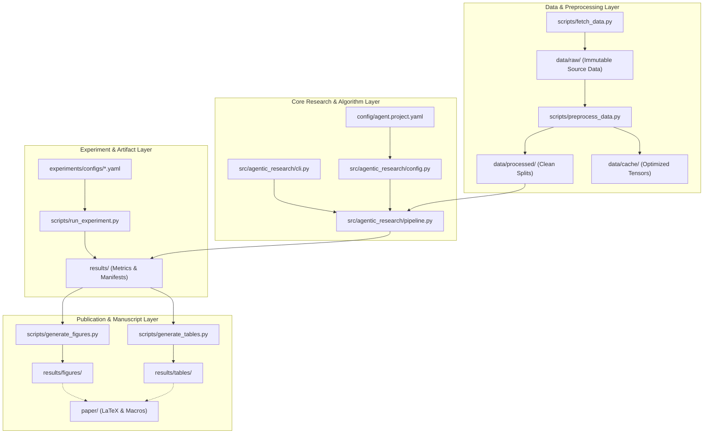

# System Architecture & Component Design

This document details the system topology, component responsibilities, data flow, trust boundaries, and runtime assumptions for projects built with this boilerplate.

---

## 1. High-Level System Architecture

---

## 2. Core Components

| Component | Module / Directory | Responsibility | Inputs | Outputs |
| :--- | :--- | :--- | :--- | :--- |
| **Config Loader** | `src/research_project/config.py` | Validates YAML/JSON configurations, seed resolution, and environment fallbacks. | Config files (`.yaml`, `.json`), CLI args | `ProjectConfig` dataclass |
| **Pipeline Runner** | `src/research_project/pipeline.py` | Orchestrates feature generation, model execution, and deterministic metrics. | `ProjectConfig`, input data arrays | `EvaluationResult` dataclass, JSON metrics |
| **Research CLI** | `src/research_project/cli.py` | Public command-line interface (`run`, `eval`, `info`) for script automation and CI. | CLI flags, config paths | Console logs, exit codes, artifacts |
| **Data Provisioner** | `scripts/fetch_data.py` | Downloads benchmark datasets, validates SHA-256 hashes, and safeguards immutability. | Remote URLs / synthetic generators | `data/raw/*.json` (validated raw data) |
| **Data Transformer**| `scripts/preprocess_data.py` | Splits data and scales features strictly on training splits to prevent leakage. | Raw data files | `data/processed/train.json`, `test.json` |
| **Experiment Engine**| `scripts/run_experiment.py` | Executes parameterized experiment matrices and logs run metadata. | `experiments/configs/*.yaml` | `results/*_metrics.json` |
| **Figure Generator** | `scripts/generate_figures.py` | Renders vector (SVG/PDF) and high-resolution raster figures for publication. | `results/*.json` | `results/figures/*.svg` |
| **Table Exporter** | `scripts/generate_tables.py` | Formats empirical metrics into LaTeX `booktabs` and Markdown tables. | `results/*.json` | `results/tables/*.tex`, `*.md` |

---

## 3. Data Flow & Trust Boundaries

1. **Ingestion & Verification:** Data downloaded into `data/raw/` is treated as external, untrusted input. Scripts must verify cryptographic hashes (SHA-256) before processing.
2. **Leakage Isolation:** Normalization parameters (mean, standard deviation, PCA components) must be calculated exclusively on training partitions. Test partitions receive only `.transform()`.
3. **Reproducibility Guarantee:** All downstream figures and LaTeX numbers trace back to structured JSON artifacts emitted by `pipeline.py`. No manual editing of plotted values is permitted.

---

## 4. Runtime & Hardware Assumptions

- **Operating Systems:** Linux (Ubuntu 22.04+), macOS (Apple Silicon / Intel), Windows 10/11.
- **Python Runtimes:** Python 3.10, 3.11, 3.12 (PEP 561 typed).
- **Compute Assumptions:** Standard multicore CPU (4+ threads), 8–16 GB RAM. Optional PyTorch CUDA/MPS acceleration when configured.
- **Offline Execution Path:** The entire pipeline executes air-gapped without requiring outbound internet access or third-party cloud services.
