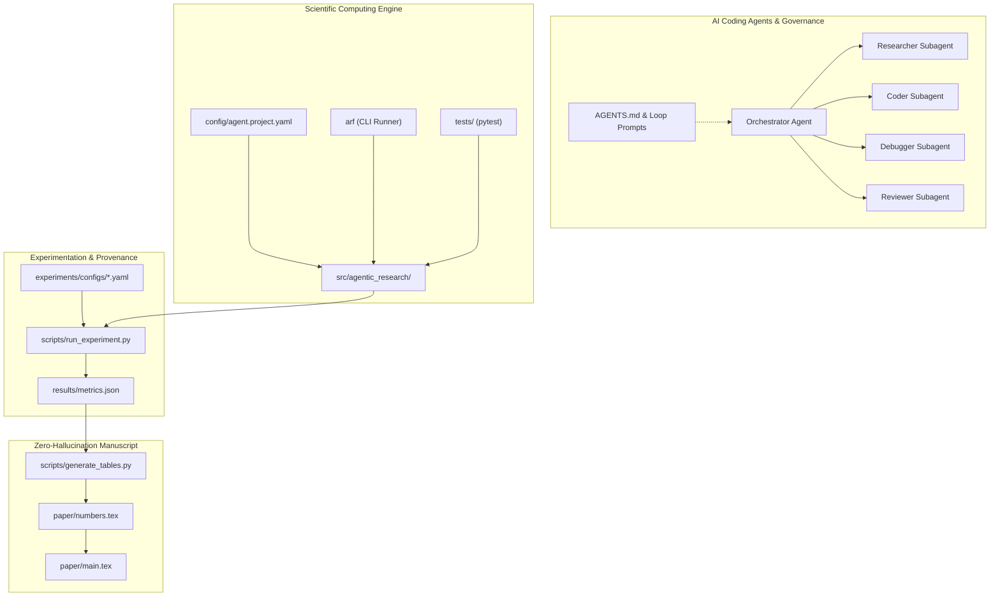

# Agentic Research Framework (ARF)

Welcome to the **Agentic Research Framework (ARF)** documentation. ARF is a production-grade, open-source research accelerator engineered for **autonomous AI coding agents** (Google Antigravity, Claude Code, Cursor, OpenAI Codex, Gemini CLI) and **human research engineers**.

---

## Why ARF?

Autonomous AI coding agents can dramatically accelerate scientific discovery—drafting implementations, exploring hyperparameter regimes, isolating edge-case bugs, and synchronizing experimental outcomes with paper manuscripts. However, without strict architectural boundaries, autonomous agents frequently hallucinate baseline comparisons, leak test data into feature preprocessors, hardcode non-existent evaluation metrics into LaTeX, or introduce non-deterministic results.

**ARF solves this by providing:**
- 🛡️ **Canonical Multi-Agent Contracts:** Universal behavior contracts in `AGENTS.md` and dedicated adapters for Claude, Gemini, Cursor, and Antigravity.
- 🔬 **Strict Research Integrity:** Zero-fabrication enforcement where all LaTeX tables and text macros originate from frozen JSON result registries (`numbers.tex`).
- 🤖 **Multi-Subagent Deep Dive Protocol:** Built-in prompts for deep-dive codebase exploration, specialized prompt synthesis, and bounded self-improvement loops.
- 📦 **Fully-Typed Starter Codebase:** A clean PEP 561 Python package (`agentic_research`), CLI entrypoints (`arf`), and out-of-the-box unit test suites.
- 🔒 **Zero-Egress Security:** Local-first defaults, air-gapped data boundaries, and strict exclusion of raw datasets and unpublished manuscript drafts.

---

## Architectural Overview

---

## Documentation Navigation

- [**Quickstart Guide**](quickstart.md): Set up your local environment, run the sample pipeline, and verify the test suite in under 5 minutes.
- [**Multi-Agent Orchestration**](multi_agent_orchestration.md): Learn how to configure subagents, enforce bounded iteration limits, and switch between coding agents.
- [**Prompt Catalog**](prompt_catalog.md): Reference manual for all structured goals (`00`-`60`) and self-improvement loops (`01`-`08`).
- [**System Architecture**](architecture.md): Deep dive into data pipelines, component contracts, and runtime boundaries.
- [**Single-Source LaTeX Macro Sync**](latex_macro_sync.md): How to eliminate manual data entry in scientific papers using automated macro generators.
- [**Reproducibility Protocol**](reproducibility.md): Manifest requirements, seed control, and data leakage audits.
- [**Security & Local Execution**](security.md): Sandboxing rules, credential management, and zero-egress policies.
