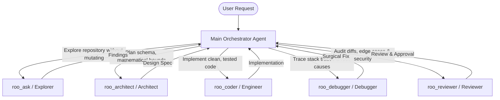

# Multi-Agent Orchestration & Subagent Delegation

The **Agentic Research Framework (ARF)** includes an advanced multi-agent governance architecture designed to prevent single-agent blindspots and hallucinated assumptions.

---

## 1. Universal Agent Contract (`AGENTS.md`)

All coding assistants must adhere to the core canonical contract in `AGENTS.md`. The contract enforces:
- **Preservation of Existing Code:** Never execute broad refactors unless explicitly instructed.
- **Evidence-Based Assertions:** Do not fabricate benchmark scores, citations, or statistical significance.
- **Zero Hardcoding in Manuscripts:** Quantitative values must originate from `results/*.json` and `paper/numbers.tex`.
- **Bounded Iteration Limits:** Automated self-improvement loops must terminate after a maximum of 5 iterations per session.

---

## 2. Specialized Subagent Personas

Complex research workflows benefit from delegating specific tasks to specialized subagents:



### Persona Responsibilities

| Subagent Persona | Role & Capabilities | Read-Only? | Typical Tasks |
|:---|:---|:---:|:---|
| **Architect (`roo_architect`)** | System architecture, schema modeling, mathematical contracts, and step-by-step phased execution plans. | Yes | Designing algorithmic extensions, hyperparameter search spaces, API interfaces. |
| **Explorer (`roo_ask`)** | High-speed codebase exploration, symbol tracking, call graph traversal, and literature reference checks. | Yes | Finding call sites, mapping configuration parameters, discovering data loading bugs. |
| **Engineer (`roo_coder`)** | Writing clean, idiomatic, PEP 561-typed code and comprehensive unit tests. | No | Implementing baseline models, metric calculations, and script automation. |
| **Debugger (`roo_debugger`)** | Troubleshooting failing unit tests, numerical instability (NaN/inf), matrix dimensionality mismatches, and memory leaks. | No | Diagnosing CUDA OOM, singular matrix inversions, and floating-point errors. |
| **Reviewer (`roo_reviewer`)** | Auditing git diffs, inspecting security boundaries, verifying test coverage, and enforcing reproducibility rules. | Yes | Pre-commit sanity checks, data leakage detection, paper number verification. |

---

## 3. Subagent Dispatch in Google Antigravity

In Antigravity, subagents are defined and launched using the `invoke_subagent` and `define_subagent` tools:

```python
# Launching a dedicated research subagent to audit datasets
invoke_subagent(
    TypeName="research",
    Role="Data Leakage Auditor",
    Prompt="Audit scripts/preprocess_data.py to verify that scalers are fit strictly on training splits."
)
```

### Communication Protocol
- Subagents execute asynchronously and send messages upon completion.
- Orchestrator agents review subagent findings before applying changes to disk.
- If a subagent encounters ambiguous scientific requirements, it prompts the orchestrator rather than making assumptions.

---

## 4. Multi-Tool Compatibility Matrix

ARF maintains compatibility adapters for all leading AI developer tools:

| Tool | Adapter File | How It Works |
|:---|:---|:---|
| **Google Antigravity** | `ANTIGRAVITY.md` & `prompts/antigravity/` | Ingests goals, loops, and multi-subagent coordination contracts. |
| **Claude Code** | `CLAUDE.md` | Auto-loaded at session start; provides concise CLI fast-commands and safety constraints. |
| **Gemini CLI** | `GEMINI.md` | System rules and command shortcuts. |
| **Cursor** | `CURSOR.md` / `.cursorrules` | Directs Composer and chat agents to maintain modularity and type safety. |
| **OpenAI Codex** | `CODEX.md` | Establishes execution guardrails and deterministic seed constraints. |
